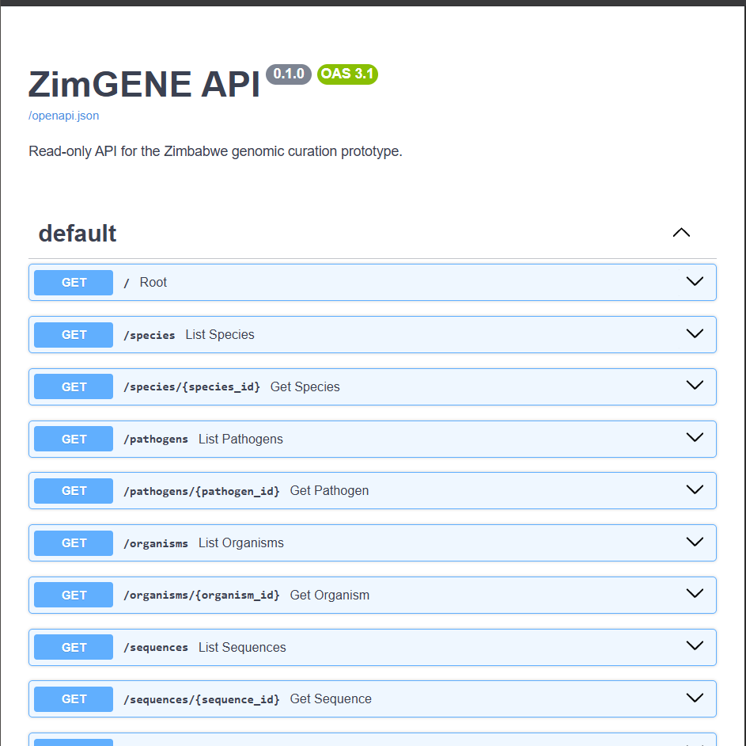

# ZimGENE

Curated genomic database and analysis pipeline for livestock and crop pathogens affecting Zimbabwe (FMDV, ASFV, TMV, Maize streak virus). Independent student project.

**Live demo:** https://zimgene-web.onrender.com
**API docs:** https://zimgene.onrender.com/docs



---

## What it does

1. A Python/BioPython pipeline pulls sequence records from NCBI via Entrez.
2.  Records are stored in a normalized PostgreSQL schema (9 tables).
3. R scripts produce GC-content and sequence-length visualizations.
4. A read-only FastAPI service exposes the data over HTTPS.
5. A plain HTML/CSS/JS frontend displays organisms and sequences.

---

## Tech Stack & Dependencies

PostgreSQL (Neon), Python (BioPython, psycopg 3, FastAPI), R (ggplot2),
HTML/CSS/JavaScript. Hosted on Render.

---

## API endpoints

| Endpoint | Description |
|---|---|
| /species, /species/{id} | Host species |
| /pathogens, /pathogens/{id} | Pathogens |
| /organisms | Specimens (filters: host_status, species_name, pathogen_name) |
| /sequences, /sequences/{id} | Sequence summaries and full records |
| /collection_site, /collection_site/{id} | Collection sites |
| /qc, /qc/{id} | QC records |

All list endpoints support ?limit= and ?offset=.

---

## Database schema

Defined in `sql/zimgene_schema.sql` (9 tables):

1. `species`, `pathogen`: reference tables for hosts (livestock, plants) and pathogens
2. `collection_site`: district, province, and coordinates
3. `contributor`: people who curate or submit data
4. `organism`: specimen records linking host, pathogen, site, and collector
5. `sequence`: nucleotide sequence, length, GC percentage, and JSONB feature annotations
6. `submission`: tracks submission status of sequences (not yet used)
7. `qc`: quality-control records per sequence
8. `audit_log`: change tracking for inserts, updates, and deletes

---

## Getting started

Developed and tested with PostgreSQL 18 and Python 3.14. R and RStudio are optional (for the plots).

### 1. Database
Create a database, then load the schema:

```
psql -U postgres -d prototype -f sql/zimgene_schema.sql
```

### 2. Ingestion pipeline (`python/`)
Create `python/.env`:

```env
PG_HOST=localhost
PG_PORT=5432
PG_DBNAME=prototype
PG_USER=postgres
PG_PASSWORD=your_password_here
NCBI_EMAIL=your_email@example.com
NCBI_API_KEY=optional
```

Then run `pip install -r requirements.txt` and `python ingest.py`

### 3. API (`api/`)
Create `api/.env` with the same `PG_*` values (or a single `DATABASE_URL` for a hosted database), then:

```
pip install -r requirements.txt
python -m uvicorn main:app --reload
```

Set `CORS_ORIGINS` to your frontend's address if it differs from the localhost defaults.

### 4. Frontend (`frontend/`)
Set `API_URL` at the top of `app.js`, then run `python -m http.server 5500` from that folder.

## 5. R plots (`r/`)
Open `visualization.R` in RStudio, choose Session > Set Working Directory >
To Source File Location, and run the script. It asks for the database password.

 ---

 ## Data and limitations

- Sequence data comes from NCBI GenBank. Search results are filtered
  to exclude PDB and patent records, but records are not independently verified.
- QC records mark NCBI accessions as pre-validated; no independent
  coverage analysis is performed at this stage.
- The free hosting tier sleeps when idle, so the first request can take up to a minute.

---

## Disclaimer
Independent student project, not affiliated with any government body.

---
